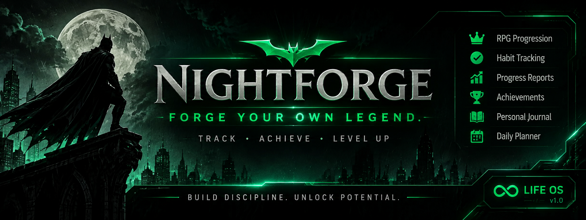
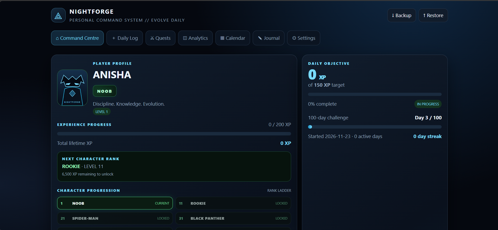

  

# 🦇 NIGHTFORGE

### Build Yourself in Silence. Let Your Progress Speak.

**NIGHTFORGE** is a personal productivity and life-tracking platform designed to turn everyday goals into a structured progression journey.

Inspired by RPG gaming systems and a dark, premium interface, NIGHTFORGE transforms personal development into a system of levels, XP, achievements, and consistency.

---

## 🎯 Project Overview

NIGHTFORGE is built around one idea:

## 📸 Project Preview

**Your life is your greatest project.**

Instead of simply tracking daily activities, NIGHTFORGE encourages users to build discipline, maintain consistency, and monitor their personal growth through a gamified experience.

## ✨ Key Features

- **RPG Progression System** – Earn XP and progress through character levels.
- **Daily XP Target** – Work towards a fixed daily target of 150 XP.
- **Character Rank System** – Unlock superhero-inspired character titles as you level up.
- **Daily Activity Tracking** – Monitor reading, studying, coding, workouts, and other activities.
- **Habit Tracking** – Build consistency through daily habit completion.
- **Streak System** – Track consecutive days of progress.
- **Achievements & Rewards** – Unlock milestones as you progress.
- **Progress Reports** – Review your daily, weekly, and monthly performance.
- **Calendar History** – Keep track of your progress over time.
- **Personal Journal** – Record thoughts and daily reflections.

## 🎮 Character Progression

Your progress determines your identity within NIGHTFORGE.

| Level | Character Title |
|---|---|
| 1 | NOOB |
| 11 | ROOKIE |
| 21 | SPIDER-MAN |
| 31 | BLACK PANTHER |
| 41 | IRON MAN |
| 51 | CAPTAIN AMERICA |
| 61 | THOR |
| 71 | HULK |
| 81 | AVENGER |
| 91 | BATMAN |
| 100 | THE DARK KNIGHT |

## 🎨 Design Philosophy

- Dark and premium visual identity.
- Batman / Jarvis-inspired aesthetic.
- Emerald green accent theme.
- Gaming-inspired dashboard.
- Clean and functional interface.

## 💻 Technology

- HTML
- CSS
- JavaScript
- Browser-based storage

## 🚀 Live Demo

[Launch NIGHTFORGE](https://maityanisha254-bit.github.io/NIGHTFORGE/)

## 📌 Project Status

**Version:** 1.0

NIGHTFORGE is an evolving personal productivity project. New features, improvements, and refinements will be introduced as development continues.

## 👩‍💻 Developer

**Anisha Maity**

- GitHub: [@maityanisha254-bit](https://github.com/maityanisha254-bit)
*Discipline is not a mood. It is a system.*

**NIGHTFORGE — Forge Your Own Legend.**
